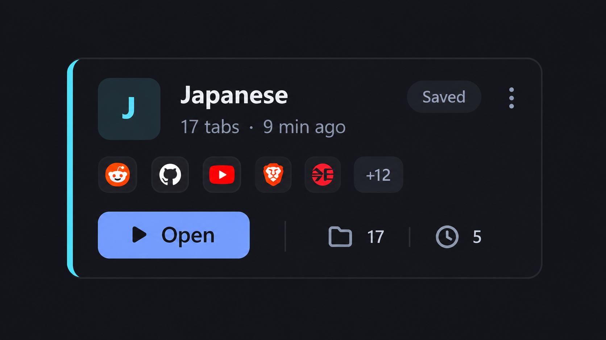
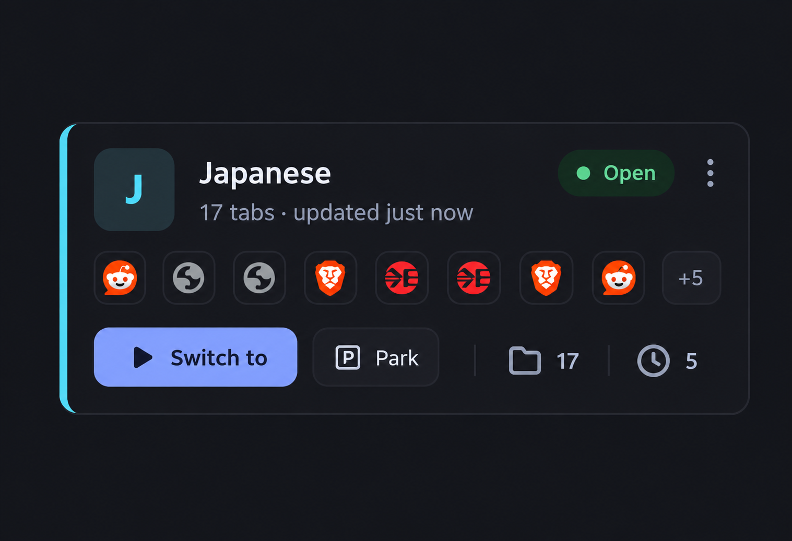

UI features

1. in the saved topics card it should icons of all the tabs saved here , instead only show unique icons and and small badge showing count of all tabs open of that particular website.
2. an appearance option in settings with few option one is that theme toggle
   3.redsign of tabs card to this
    with its state card being like 

Feature

1. whenever i open a broswer it should always only be an home page , the last tabs opened shouldn't be reopened it should be only the home page, for the last tabs opened if the last tabs closed window as not a topic window if closed save it as the last opended tabs
